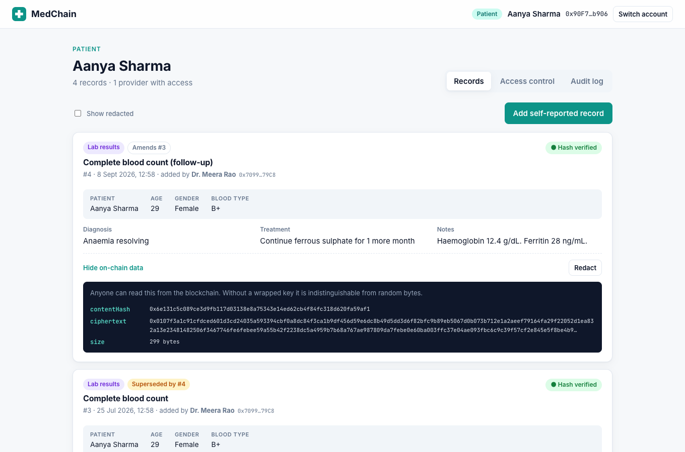
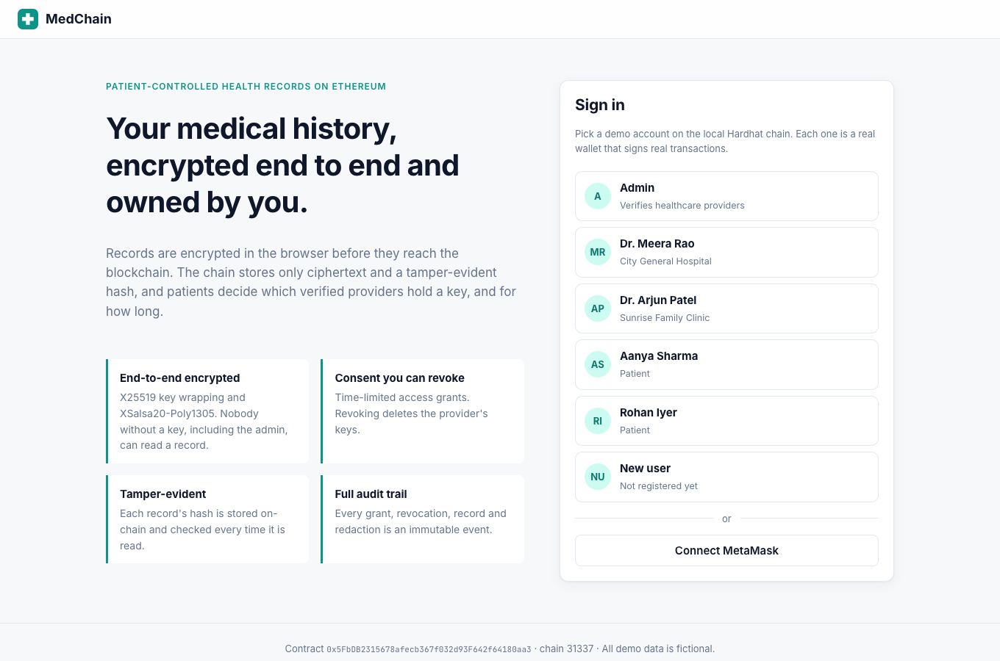
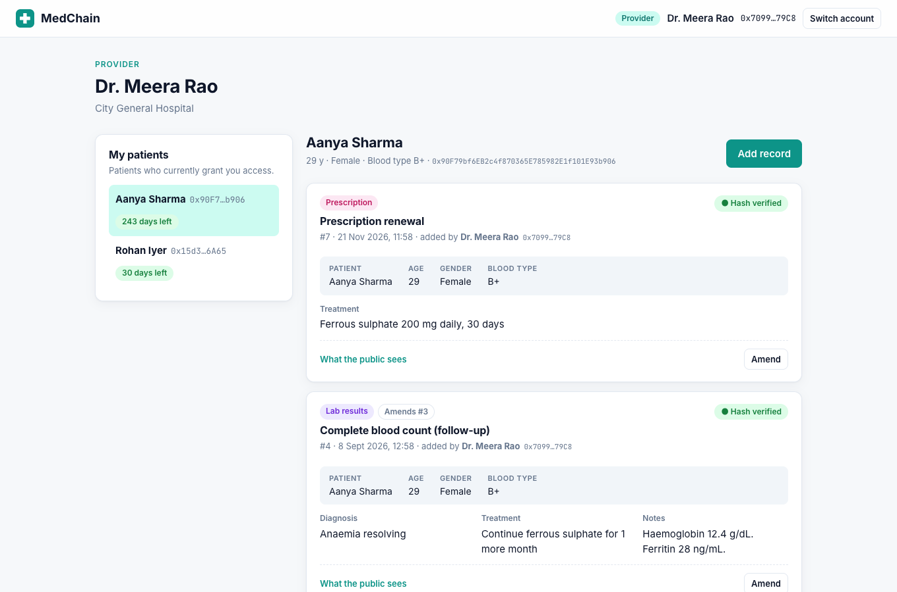
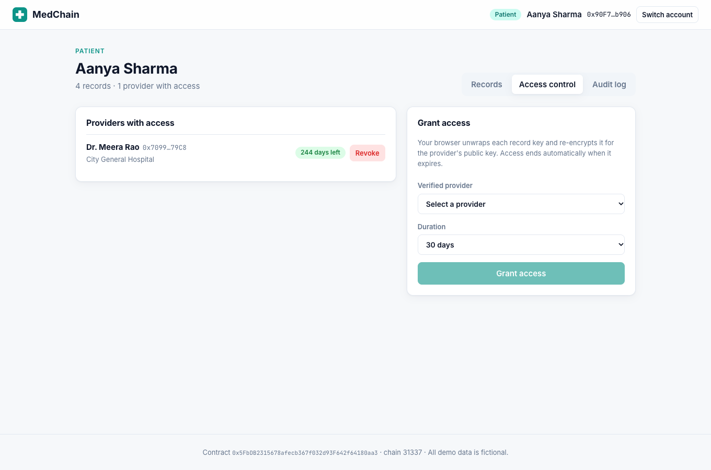
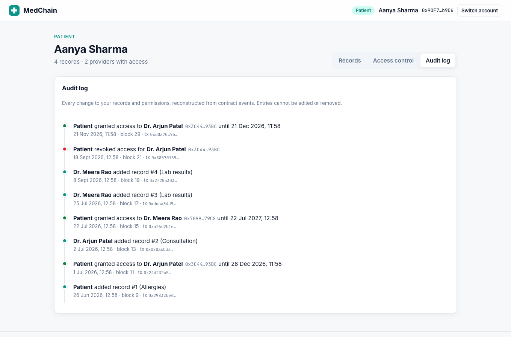
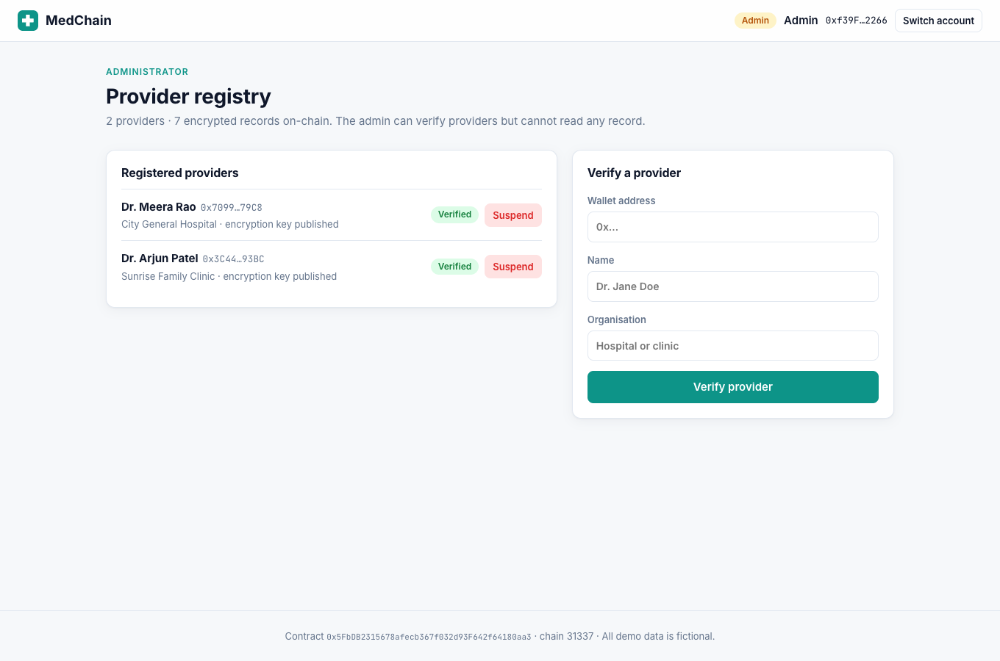
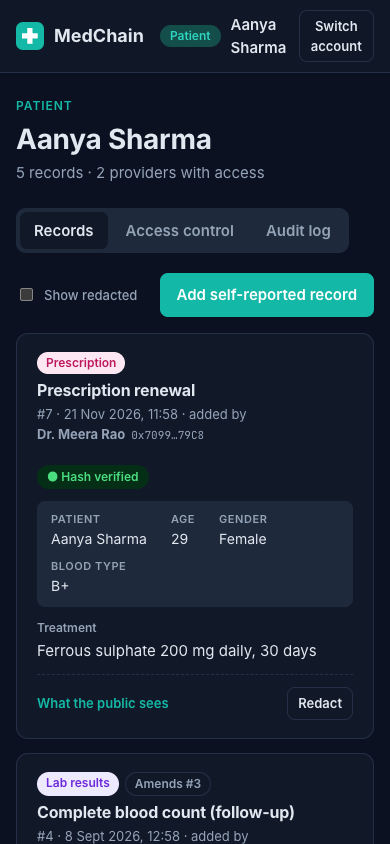
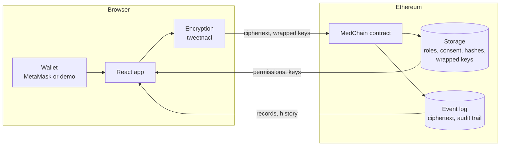
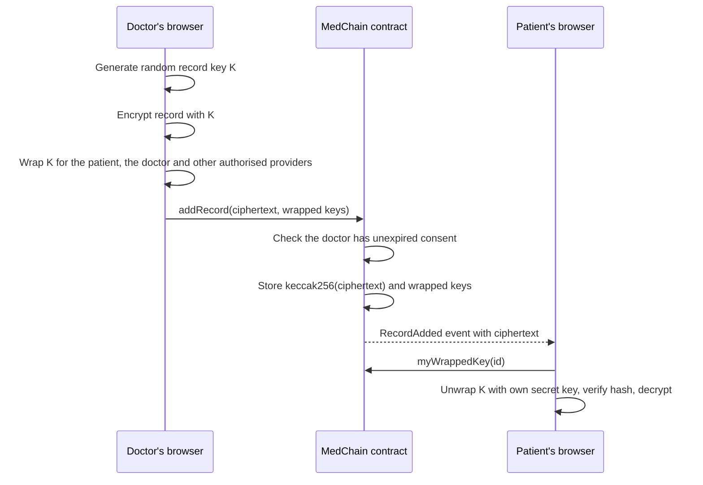

# MedChain: Patient-Controlled Medical Records on Ethereum

MedChain is a decentralised application for storing and sharing medical records. Records are encrypted in the browser before they reach the blockchain, so the chain holds only ciphertext and a tamper-evident hash. Patients decide which verified healthcare providers can read their history, for how long, and can revoke that access at any time. Every change is recorded as an immutable audit trail.

[](https://github.com/anaghama-beep/medchain/actions/workflows/ci.yml)




## The problem

Medical records are scattered across hospitals and clinics that do not share a common system. Patients carry paper copies between appointments, doctors repeat tests because earlier results are unavailable, and centralised databases are attractive targets for breaches. Paper reports and diagnoses can also be forged.

A blockchain gives every participant the same tamper-proof ledger, but a naive design that writes medical data to a public chain makes it permanently readable by anyone. MedChain keeps the benefits of a shared ledger (integrity, availability and auditability) while ensuring that only the patient and the people they authorise can read the contents.

## Features

- **End-to-end encryption.** Each record is encrypted with a fresh key in the browser (XSalsa20-Poly1305). That key is wrapped for each authorised reader with X25519, so nobody without a wrapped key can read the record. That includes the admin, node operators and anyone reading the chain.
- **Patient-controlled consent.** Patients grant time-limited access to verified providers. Granting re-encrypts the keys of existing records for the provider; revoking deletes them from the contract.
- **Provider verification.** An administrator verifies healthcare providers and can suspend them, which cuts off their access immediately. The admin cannot read any record.
- **Tamper evidence.** The keccak256 hash of every ciphertext is stored on-chain and checked each time a record is displayed.
- **Amendments and redaction instead of deletion.** Corrections are new records that reference the original, and patients can redact records from default views. The history stays on the ledger, which is what makes it trustworthy.
- **Immutable audit log.** Every grant, revocation, new record and redaction is an event, shown to the patient as a timeline.
- **No extra secrets to manage.** Each user's encryption key pair is derived from a wallet signature, so the wallet is the only credential and the same key is recovered on any device.
- **"What the public sees" view.** Each record can show the raw bytes stored on-chain next to the decrypted version.

## Screenshots

| Sign in | Provider workspace |
|---|---|
|  |  |
| **Access control** | **Audit log** |
|  |  |
| **Provider registry (admin)** | **Mobile, dark mode** |
|  |  |

## How it works



### Adding a record



### Key management

Every account's X25519 key pair is derived as `keccak256(signature)`, where the signature is over a fixed message. Wallets produce deterministic ECDSA signatures (RFC 6979), so the same wallet always yields the same key. Only the public key is published on-chain.

A record key is wrapped with a one-time ephemeral key pair (`ephemeral public key | nonce | box`, 104 bytes), so wrapped keys reveal nothing about who created them. When a patient grants access, their browser unwraps its own copy of each record key and re-wraps it for the provider. The contract never sees a plaintext key.

### Where data lives

| Data | Location | Visible to |
|---|---|---|
| Medical content (diagnosis, treatment, notes, demographics) | Event log, encrypted | Holders of a wrapped key |
| Content hash | Contract storage | Everyone |
| Wrapped record keys | Contract storage | Everyone, but useless without the matching secret key |
| Roles, consent grants and expiry, record category, timestamps | Contract storage and events | Everyone |

## Security model

| Party | Can read records? | Notes |
|---|---|---|
| Patient | Yes, all of their own | Holds a wrapped key for every record about them |
| Provider with current consent | Yes | Keys for existing records are shared at grant time, and new records are wrapped for them automatically |
| Provider after revocation or expiry | No new reads | Their wrapped keys are deleted, and the contract refuses access |
| Suspended provider | No | Access checks require an active provider |
| Administrator | No | Can verify and suspend providers only |
| Public, node operators | No | See ciphertext, hashes and metadata only |

**Limitations, stated honestly:**

- Revocation stops future access but cannot recall data a provider has already decrypted and saved. No system can.
- Metadata is public. An observer can see that an address is a patient, which providers it has authorised, when records were added and their category. Addresses are pseudonymous, but this still matters for a production deployment.
- Ciphertext in the event log is permanent. If an encryption scheme were broken in future, old records would be exposed. Storing ciphertext off-chain (for example on IPFS, with only the hash on-chain) would allow deletion of the data itself.
- The project is a demonstration and is not certified for regulated health data (HIPAA, GDPR or India's DPDP Act).

## Smart contract

[`contracts/MedChain.sol`](contracts/MedChain.sol)

| Function | Caller | Purpose |
|---|---|---|
| `registerProvider(address, name, organisation)` | Admin | Verify a provider |
| `setProviderActive(address, bool)` | Admin | Suspend or reinstate a provider |
| `registerPatient(pubKey)` | Anyone | Create a patient profile with an encryption key |
| `setEncryptionKey(pubKey)` | Anyone | Publish a key (providers do this once) |
| `grantAccess(provider, expiry, recordIds, wrappedKeys)` | Patient | Grant time-limited access and share existing record keys |
| `revokeAccess(provider)` | Patient | Revoke access and delete the provider's keys |
| `addRecord(patient, category, ciphertext, supersedes, readers, wrappedKeys)` | Patient or authorised provider | Add an encrypted record, optionally amending an earlier one |
| `redactRecord(id)` | Patient | Hide a record from default views |
| `getPatientRecords(patient)`, `myWrappedKey(id)`, `hasAccess(patient, provider)` | | Read-side helpers with access checks |

Access checks on view functions improve the developer experience but are not a privacy boundary, since anyone can read raw contract storage. Confidentiality comes entirely from the encryption.

## Tech stack

| Layer | Technology |
|---|---|
| Smart contract | Solidity 0.8.24, Hardhat, custom errors, events for indexing |
| Encryption | tweetnacl (X25519, XSalsa20-Poly1305), keccak256 |
| Frontend | React 18, TypeScript, Vite, ethers v6 |
| Wallets | MetaMask (EIP-1193), plus built-in demo accounts for local use |
| Testing | Hardhat with Mocha and Chai (16 contract tests), Vitest (5 encryption tests), Playwright for end-to-end checks |
| CI | GitHub Actions: compile, test, type-check, build |

## Getting started

Requires Node.js 20 or later.

```bash
git clone https://github.com/anaghama-beep/medchain.git
cd medchain
npm install
npm run dev
```

`npm run dev` starts a local Hardhat blockchain, deploys the contract, seeds it with fictional demo data, and opens the app at http://localhost:5173. Sign in as any demo account:

| Account | Role | Try this |
|---|---|---|
| Aanya Sharma | Patient | Read decrypted records, compare them with the on-chain data, grant or revoke access, view the audit log |
| Dr. Meera Rao | Provider | Open a patient, add or amend a record |
| Dr. Arjun Patel | Provider | His access was revoked; ask Aanya to grant it again |
| Admin | Administrator | Verify or suspend providers |
| New user | Unregistered | Create a patient profile |

To use MetaMask instead, add the network `http://127.0.0.1:8545` (chain ID 31337) and import one of the private keys printed by the Hardhat node.

### Commands

```bash
npm test              # contract tests and encryption tests
npm run typecheck     # TypeScript
npm run build         # production build of the frontend
npm run chain         # start only the Hardhat node
npm run deploy:seed   # deploy and seed against a running node
```

### Deploying to a testnet

```bash
export SEPOLIA_RPC_URL=https://...    # from Alchemy, Infura or similar
export DEPLOYER_KEY=0x...             # a funded testnet account
npx hardhat run scripts/deploy.js --network sepolia
VITE_RPC_URL=$SEPOLIA_RPC_URL npm run build
```

The deploy script writes the contract address and ABI to `frontend/src/contracts/MedChain.json`, which the frontend reads.

## Project structure

```
contracts/MedChain.sol          smart contract
test/MedChain.test.js           contract tests
scripts/deploy.js               deployment and demo data seeding
frontend/src/
    lib/crypto.mjs              envelope encryption and key derivation (shared with the seed script)
    lib/crypto.test.mjs         encryption tests
    lib/chain.ts                wallet connection, demo accounts, contract instance
    lib/records.ts              loading, decrypting, adding and sharing records; audit log
    components/                 patient, provider and admin views
docs/screenshots/               images used in this README
```

## Roadmap

- Store ciphertext on IPFS or Arweave, keeping only the content hash on-chain, so large files such as imaging can be supported and data can be deleted.
- Use proxy re-encryption so that granting access does not require one transaction entry per record.
- Add key rotation and social recovery for patients who lose their wallet.
- Replace the single admin with a multisig or a consortium of hospitals.
- Index events with The Graph for faster loading of long histories.
- Add emergency "break-glass" access for unconscious patients, with mandatory audit.
